  

  
  
  
  

## About me

I'm an AI engineer based in Alexandria, Egypt. I build deep learning models from the ground up, from implementing architectures in PyTorch to turning them into working applications people can use.

My work covers three areas: **generative AI** (diffusion models), **NLP and speech** (transcription, summarization, RAG), and **computer vision** (classification and pose tracking). I also taught AI courses at university level, so I'm used to explaining technical decisions clearly to teammates and clients.

  

## Featured projects

| Project | What it does | Result | Stack |
|---|---|---|---|
| 🦾 **[Smart Rehabilitation System](https://github.com/Habibawally/Smart-Rehabilitation-System)** Graduation project | Remote physiotherapy app that tracks exercises with sEMG, IMU and ECG sensors and gives patients feedback | **80.1%** movement classification accuracy | GRU, Random Forest, LRCN, MediaPipe, Flutter || 🎨 **[Diffusion Model from Scratch](https://github.com/Habibawally/Image-Generation-with-Diffusion-Models)** | Denoising diffusion model that generates images, built without any diffusion library | Full DDPM with 1,000 timesteps | PyTorch, ResNet18, self-attention |
| 🎧 **[Podcast Summarization & Emotion Detection](https://github.com/Habibawally/podcast-summarization-emotion-detection)** | Turns podcast audio into a transcript, a short summary and an emotional tone reading | End-to-end pipeline with desktop GUI | Whisper, DistilBART, Librosa |
| 🍎 **[Fruit Quality Classification](https://github.com/Habibawally/Quality-of-fruits)** | Sorts fruit images into good, bad and mixed quality across 6 fruit types | **96.2%** test accuracy on 18 classes | InceptionResNetV2, TensorFlow |
| 📄 **[RAG Question Answering](https://github.com/Habibawally/RAG-QuestionAnswering-System)** | Answers questions from your own documents instead of guessing | Grounded answers over custom files | LangChain, ChromaDB, Gemini |
| 🖼️ **[Image Captioning](https://github.com/Habibawally/Image-Captioning-CNN-LSTM)** | Describes images in natural language | Presented to the ZAKA AI technical team | CNN encoder, LSTM decoder |

More: <a href="https://github.com/Habibawally/HumanActivityRecognition">Human Activity Recognition</a> · <a href="https://github.com/Habibawally/Cancer-RAG-Chatbot-Langflow">Cancer RAG Chatbot</a>

## How I can help

For **companies hiring** and **freelance clients**, these are the kinds of problems I solve, each backed by a project above:

- **Custom AI chatbots over your documents:** RAG assistants that answer from your own files, policies or knowledge base
- **Image and video AI:** quality inspection, image classification, and pose or movement tracking
- **Speech and audio AI:** transcription, meeting or podcast summaries, and audio analysis
- **Custom deep learning models:** from data preparation and training to evaluation and a working demo

## Tech stack

  
  
  
  
  
  
  
  
  
  
  
  

**Models and techniques:** Transformers · Whisper · RAG · Diffusion models · CNNs · LSTM/GRU · Transfer learning

## Experience

- **Teaching Assistant, AI Department** · Pharos University in Alexandria · 2025 to 2026 Supported Speech Recognition, NLP, Robotics and Data Mining courses
- **Head Technical Ambassador** · ZAKA AI · since 2024 Lead AI competitions and technical training sessions
- **Co-Founder** · Google Developer Student Club, Pharos University · 2023 to 2024 Organized DevFest On-Campus Alexandria 2023

## Currently learning

LLM agents and agentic workflows.

---

  <b>Have an AI project in mind, or hiring for an AI role?</b> 
  I'd love to hear about it: <a href="mailto:habibawally35@gmail.com">habibawally35@gmail.com</a>

